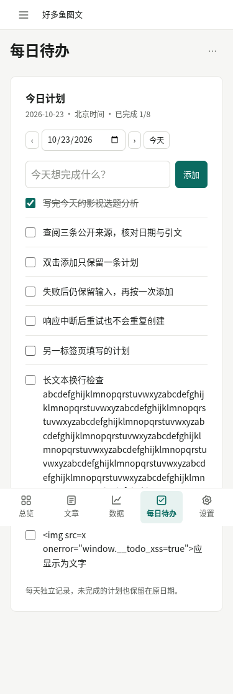
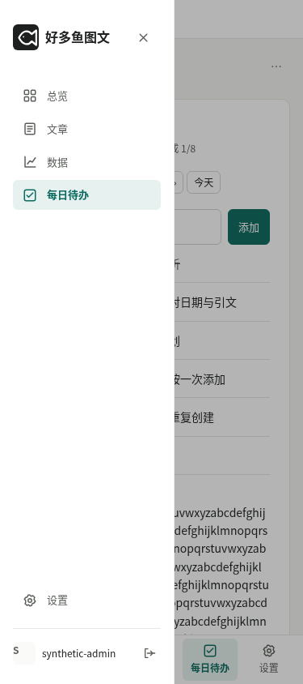
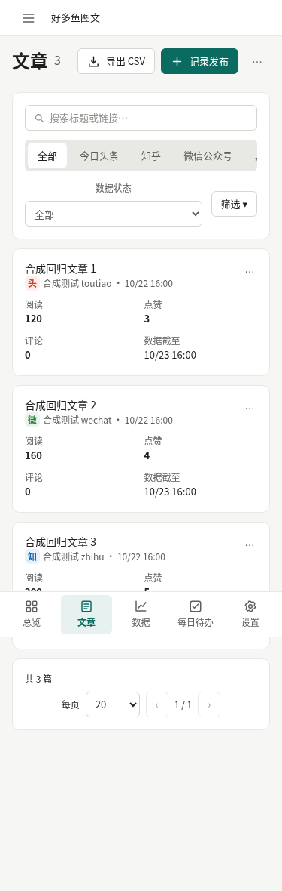
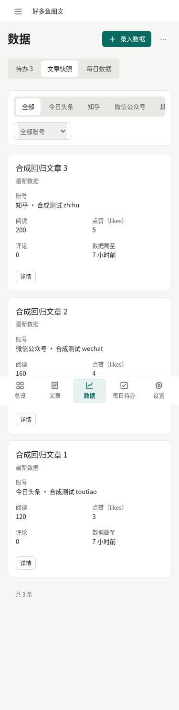
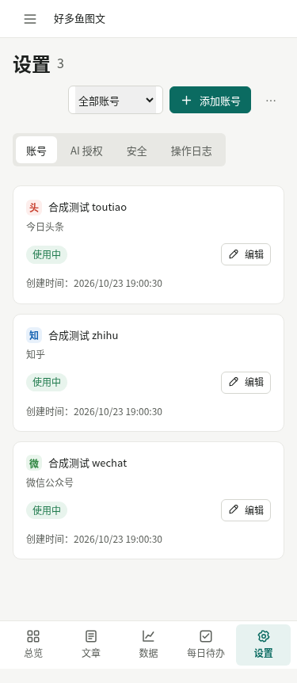
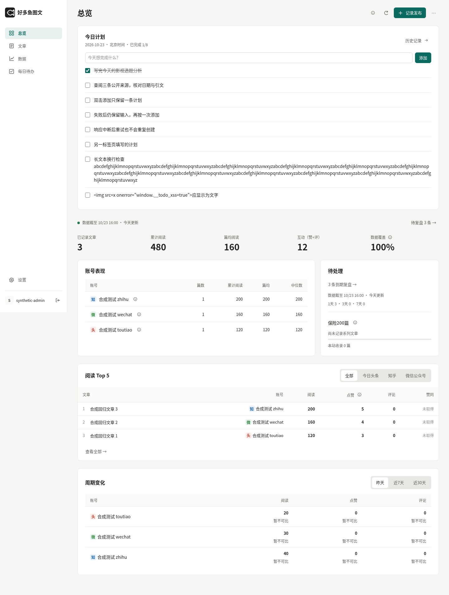

# 每日待办与手机布局：合成浏览器截图

最新整合版：[极简独立待办、日历与常用模板的7张截图](minimal/README.md)，来源提交 `922053e`。

早期最小修正：[长清单失败提示首屏截图与验收](feedback-acceptance.md)。下方32张是修正前的完整验收截图，来源提交分别标明。

这 32 张截图来自本地真实 Chromium 154；375/390 为触控仿真、1440 为桌面。仅包含隔离合成数据，无生产用户记录。截图对应产品提交 `0ea80af132d361897074f2b41c428d27a3d53630`；PR #35 冻结 head `814126dfd25b174aecba2d7ad49f5a74a52b95b5`。本分支仅交付证据，不修改产品，也不用于部署。

[逐图 SHA-256 清单](manifest.json) · [完整测试证据](../../daily-todos-evidence.json)

## 手机今日待办（375）

## 手机导航（375）

## 手机文章（375）

## 手机数据（375）

## 手机账号（375）

## 桌面首页（1440）

## 全部截图

- [dashboard-375.png](dashboard-375.png)
- [todos-375.png](todos-375.png)
- [history-empty-375.png](history-empty-375.png)
- [articles-375.png](articles-375.png)
- [reviews-observations-375.png](reviews-observations-375.png)
- [settings-accounts-375.png](settings-accounts-375.png)
- [dashboard-390.png](dashboard-390.png)
- [todos-390.png](todos-390.png)
- [history-empty-390.png](history-empty-390.png)
- [articles-390.png](articles-390.png)
- [reviews-observations-390.png](reviews-observations-390.png)
- [settings-accounts-390.png](settings-accounts-390.png)
- [dashboard-1440.png](dashboard-1440.png)
- [todos-1440.png](todos-1440.png)
- [history-empty-1440.png](history-empty-1440.png)
- [articles-1440.png](articles-1440.png)
- [reviews-observations-1440.png](reviews-observations-1440.png)
- [settings-accounts-1440.png](settings-accounts-1440.png)
- [mobile-default-todos-375.png](mobile-default-todos-375.png)
- [touch-articles-375.png](touch-articles-375.png)
- [touch-reviews-observations-375.png](touch-reviews-observations-375.png)
- [touch-settings-accounts-375.png](touch-settings-accounts-375.png)
- [touch-dashboard-375.png](touch-dashboard-375.png)
- [mobile-navigation-375.png](mobile-navigation-375.png)
- [mobile-default-todos-390.png](mobile-default-todos-390.png)
- [touch-articles-390.png](touch-articles-390.png)
- [touch-reviews-observations-390.png](touch-reviews-observations-390.png)
- [touch-settings-accounts-390.png](touch-settings-accounts-390.png)
- [touch-dashboard-390.png](touch-dashboard-390.png)
- [mobile-navigation-390.png](mobile-navigation-390.png)
- [automatic-beijing-midnight-1440.png](automatic-beijing-midnight-1440.png)
- [yesterday-preserved-1440.png](yesterday-preserved-1440.png)
