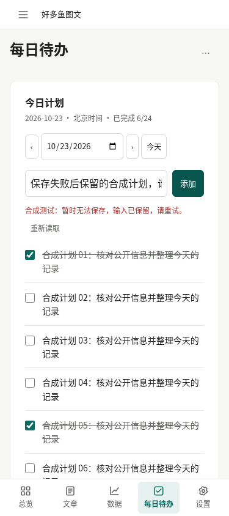

# 长清单保存失败：首屏提示

产品提交 `9d2c2246c29b93839a123a01445ffe9cd5d9a5ee`，仅将失败反馈移到输入表单下方。

375×844 触控 Chromium，24 项合成计划、6 项完成。提示位于 y333.78–392.97，首屏无需滚动。503 后输入及旧状态保持；主动重试复用同一 ID，只新增一项。截图不含生产记录。

[精确验收及测试收尾异常说明](https://github.com/haohaoyu-AI/haoduoyu-web/blob/9d2c2246c29b93839a123a01445ffe9cd5d9a5ee/docs/daily-todos-feedback-evidence.json)。

原测试进程在产品断言通过后读取旧 Response body 失败；实际资产字节已通过独立只读浏览器补验，未重跑业务写入。触控日期箭头高40px、宽21.625px；日期输入高44px；内部5点命中检查通过。

截图 SHA-256：`33ac62263ff7387d55550f839aa2e55918a993afc36fc394d4bf3ef1658c1e66`。
