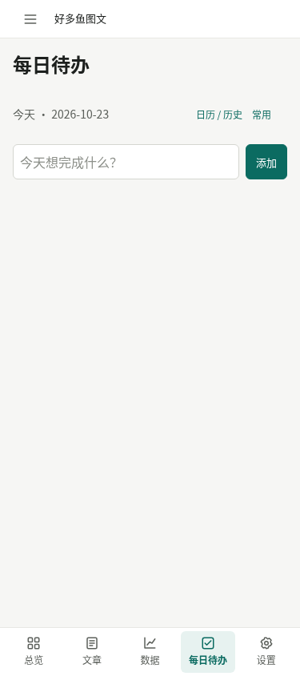
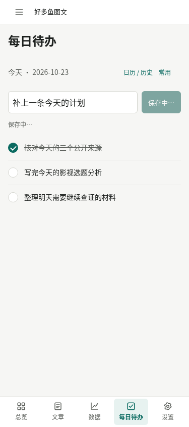
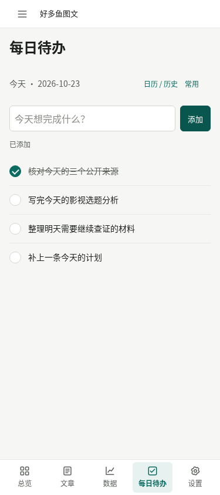
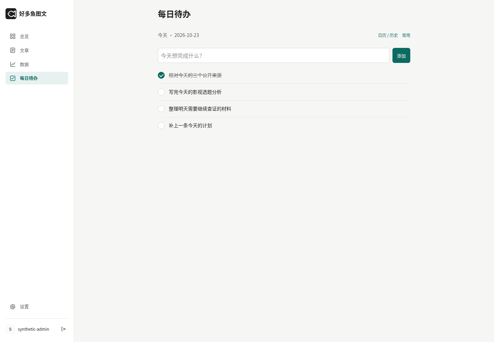
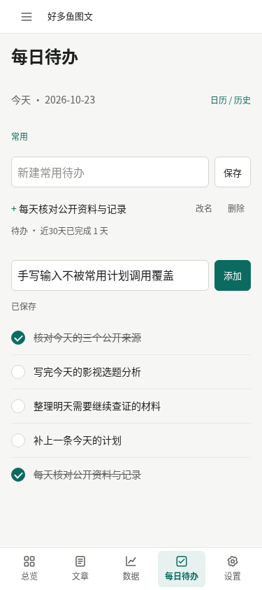
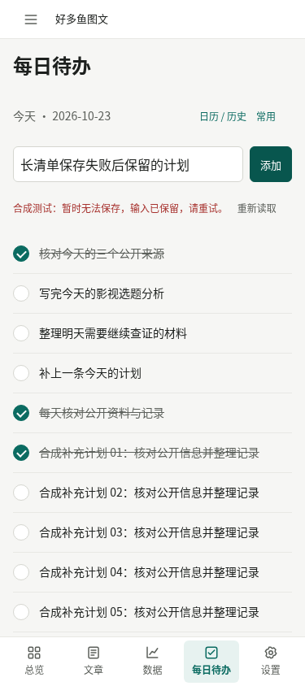
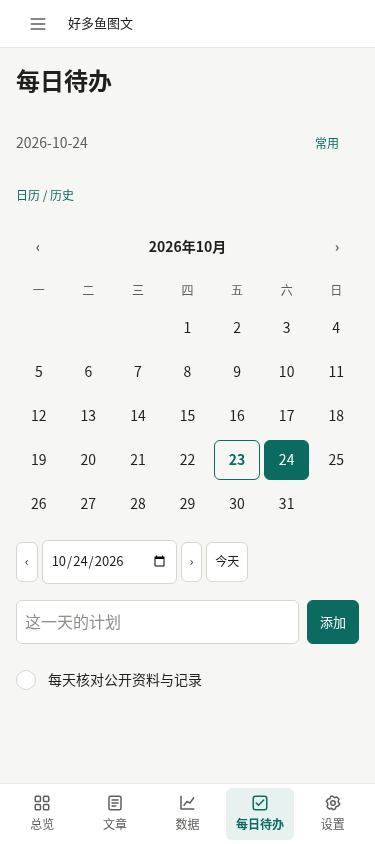

# 极简每日待办：整合版浏览器验收

产品提交：`922053e7a0a380c485df0e87e5a1feac3bc2c74f`。本地 Chromium 154，375px 触控仿真与1440px桌面，16/16定向检查首轮通过。全部图片仅含隔离合成数据，无生产用户记录。

待办独立默认页，显式自媒体统计入口保留；圆形勾选、日历历史/未来、常用模板管理和调用已验证。长清单保存失败提示位于首屏且保留输入。近30天21日规则边界由后端合成测试验证，浏览器检查统计0→1。

[逐图校验与检查索引](manifest.json)

仅为本地浏览器验收，尚未生产部署。不是实体手机或网络速度保证。

## 375-default

## 375-list-saving

## 375-list-saved

## 1440-default

## 375-common-templates

## 375-long-list-failure

## 375-history-expanded

