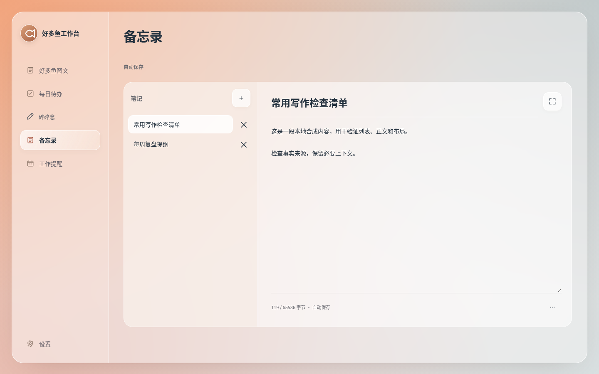
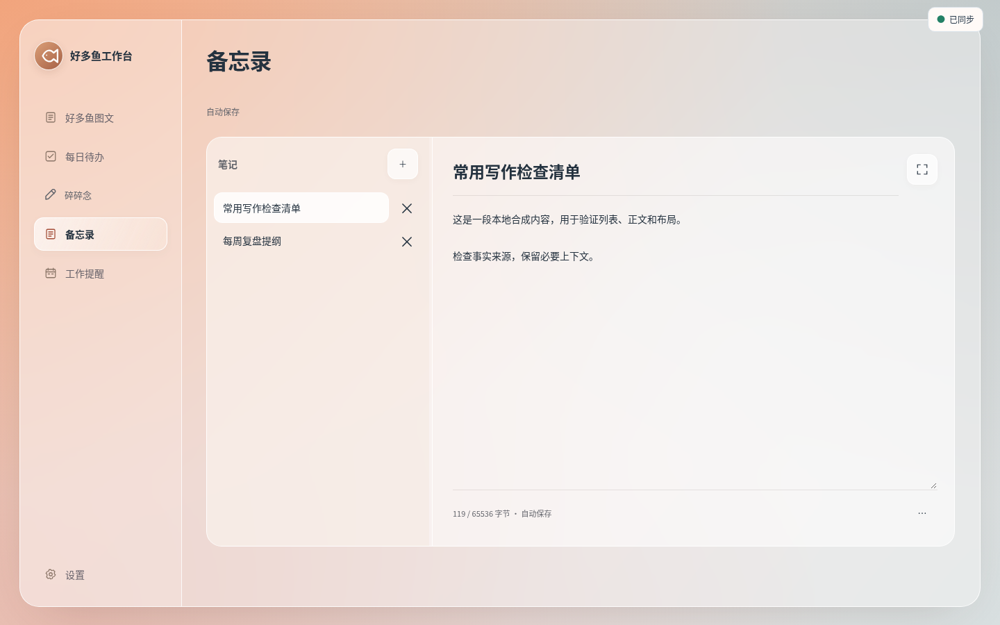
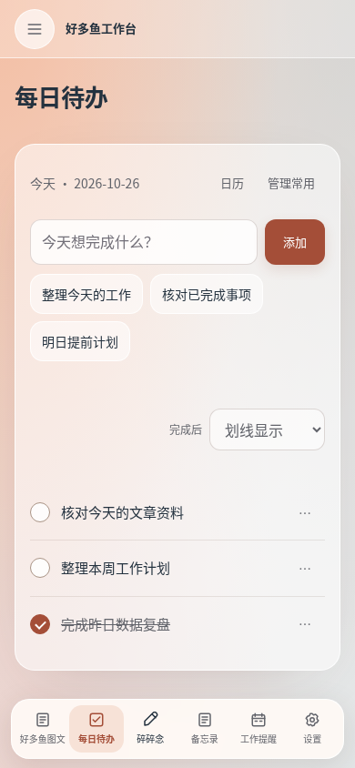
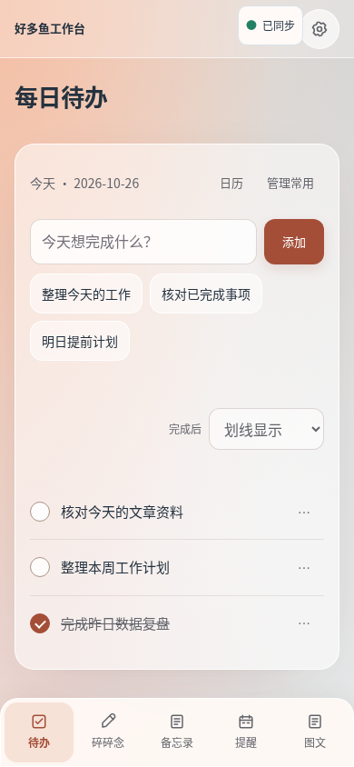

# 好多鱼网页与 App 统一改进报告

报告日期：2026-10-27（北京时间）。更新于 2026-10-27 03:43:00 北京时间 / 2026-10-26 19:43:00 UTC。

**云端开发与合成验收已完成，线上没有部署本轮改动。** 完整 v9 备份导出返回 401，按计划 H4，本晚不部署。原网站继续使用已确认的 `49e1e590-e246-4bfa-95ea-4165e522c068`；没有改动真实业务数据。

你现在无需安装或操作。后续发布须先成功导出并校验新鲜完整备份、完成实际页面验收；正式 App 还须下次家机可用时使用原签名密钥构建。不要卸载旧 App。

## 完成内容

- 桌面暖杏磨砂风格保持，设计参数统一到 tokens；手机统一五项底栏，设置在右上角，图文只显示总览。App 复用同一套网页。
- 外壳离线可打开，API 不由 Service Worker 缓存；新版本由用户点击更新，更新前先保住本机输入。
- 待办/常用项、新生活与工作碎碎念、备忘录可先可靠保存本机，再串行同步。旧逐日碎碎念只读保留；提醒离线只读，数据总览显示最后缓存时间，设置需联网。备忘录离线支持新增/编辑，删除和恢复需联网。
- 冲突可以实际选择用本地、用线上或另存双份；旧请求与双方正文继续保留。线上有新版本或输入又变化时重新比较，真实确认后才显示完成。已删除原记录不会被自动复活。
- App 3.0.0 薄壳、旧 SQLite 保全和迁移、旧任务未保存草稿恢复已通过云端构建与合成测试。原来未同意公开上传的旧本机内容仅保留查看/导出，不自动上传。

## 截图

以下均是同一临时 D1 合成数据的截图，**不是生产截图，不包含用户真实笔记**。前为生产源 `6e2e445` 的本地预览，后为最终产品源 `73e5315`。

| 电脑备忘录：前 | 电脑备忘录：后 |
|---|---|
|  |  |

| 手机待办：前 | 手机待办：后 |
|---|---|
|  |  |

最终七页 × 1440/390 共 14 图，以及七页 375 宽检查均通过：无横向溢出、输入字号低于 16px 或触控区低于 44px。桌面除新增同步图标区域外像素差 0%，原始全图最大约 0.217%。残余像素均保留统计，没有额外遮罩。

## 固定提交与完整 CI

以下是各阶段最后成功的固定候选，全部零失败、取消或跳过；网页 secret scan、资源校验、前端构建和两种预览均通过。测试有重叠，不将这些数量相加冒充独立新增测试。

| 阶段 | 分支 | 固定提交 | 完整 CI |
|---|---|---|---|
| 设计变量 | `opt/unify-web-stage1` | `cff158bd02693d81ef1be4c186ac9e25ff34a1dd` | [892/892](https://github.com/haohaoyu-AI/haoduoyu-web/actions/runs/40363472024) |
| 手机统一布局 | `opt/unify-web-stage2` | `53c0752d8b6484358021f7df08fa2ef63e3e2760` | [905/905](https://github.com/haohaoyu-AI/haoduoyu-web/actions/runs/40368001817) |
| SW 外壳 | `opt/unify-web-shell` | `1f7ea4699fe46dcf062fa2cac486493f3a0f9339` | [925/925](https://github.com/haohaoyu-AI/haoduoyu-web/actions/runs/40368020168) |
| 待办离线 | `opt/unify-web-offline-todos` | `8b53d937921cec2e54fcc7a1d846082be591d6d1` | [1039/1039](https://github.com/haohaoyu-AI/haoduoyu-web/actions/runs/40379266398) |
| 碎碎念离线 | `opt/unify-web-offline-notes` | `1ee0acd4be792b1f26a4febe6b2018716522c288` | [1112/1112](https://github.com/haohaoyu-AI/haoduoyu-web/actions/runs/40379273571) |
| 备忘录离线 | `opt/unify-web-offline-memos` | `ec96f40c464dbb985f8d3f6d0f321335cb9ecda5` | [1135/1135](https://github.com/haohaoyu-AI/haoduoyu-web/actions/runs/40385351515) |
| 完整冲突处理 | `opt/unify-web-offline-complete` | `b242cd573ab05c2fae2d5af779d7275ca45c20ad` | [1302/1302](https://github.com/haohaoyu-AI/haoduoyu-web/actions/runs/40386362366) |
| Android 3.0.0 | `android/unified-v3` | `0d1268428e9ce860fae83b999e7dc1932a4f3a61` | [117 JVM +21 Node；旧源码另 80 JVM +16 Node](https://github.com/haohaoyu-AI/haoduoyu-web/actions/runs/40372760071) |

定向验证另包含待办 6、碎碎念 8、备忘录 7、完整冲突 6 组真实 Chromium 场景；冲突处理 7 组真实 Worker/D1、6 项真实旧 D 消费者兼容检查。早期失败已定位修复并由上述新提交完整成功覆盖，未删减或跳过检查。备忘录旧 `be257bd` 包含已修正的加载竞态，已标记作废，不在本次候选包中。

## 未执行的发布事项

- **H4：完整备份失败。** 没有有效 v9 全备份；公开快照/61 实体只读基线不替代全库备份。
- 生产实际七页 × 电脑/手机截图仍 0/14，生产冒烟、实际发布和回滚未执行。本地外壳更新/版本切换测试不能代替生产客户端验收。
- 正式 APK 没有使用原签名密钥签名，也未安装或实机验收。保留旧 APK 不代表 Android 允许直接从 versionCode 4 降级到 3，不能靠卸载回退而丢失本机数据库。

新部署截止为北京时间 2026-10-27 09:00（UTC 01:00），但本晚已触发 H4，因此无论 CI 成功与否都不新部署。后续须正规管理员登录成功导出并验证 30 分钟内的新鲜 v9 全备份、确认回退点、完成实际验收，再由发布专责按阶段分别发布。

没有新增数据库迁移、运行绑定、凭据或账户权限。业务 API、匿名业务编辑和后台保护保持；Worker 只增加了离线外壳所需的静态资源支持。本轮没有改动头条/知乎另一套发布流水线或 Notion 工作线。

## 产物校验

每个阶段独立打包 Worker、manifest 和说明；包不含凭据、配置、数据库或原始参考图。最后确认的生产 Worker 为 1,244,076 bytes，SHA256 `737f212f71725556f19dba0e451fee44e322370f6304cf405c6681a92fbe7fe3`，部署 `baa156ea-5f3b-439c-81ad-6ff762f87a78`，版本 `49e1e590-e246-4bfa-95ea-4165e522c068` 100%，来源 `6e2e445e8a3e9f7a4af055f4cf75046cf6e5cd6c`。本任务未改变该部署。

| Worker 候选 | bytes | SHA256 |
|---|---:|---|
| 设计变量 | 1,265,642 | `52e4c7b7901ea8019370492eac20565a7284559a1e866b6ed975c75fc45620cc` |
| 手机统一布局 | 1,280,513 | `f9e34238880f01789712f016e00966c16b4f10fa6b70924c63aae581801a93a4` |
| SW 外壳 | 1,297,715 | `9ec2e67ddab8b70aa4fad79be2f6df3243b52a52ef87482b1b5a3d911df3f85f` |
| 待办离线 | 1,396,279 | `70765264460b32495080d279d3f8306112c87c315c2e029335323e4c3f4d3cff` |
| 碎碎念离线 | 1,451,324 | `d938ef04ce3c4977a8421025c9b4136e4a11e663ee163155264ec29fea8038ec` |
| 备忘录离线 | 1,478,162 | `457b33dc8a139beb9147c42eefc0bb1c38a4f1f15dd707c0b0765cafb1d03de9` |
| 完整冲突处理 | 1,526,368 | `f93c991a137a8f5c3b66360b9c5447a8c618ba23c2165fe68488423b9169e375` |

Android unsigned release：85,128 bytes，SHA256 `5af0bb9cff980a17cca576d5bb20cbc8671e00bde9382096971b0a3c79f50f0a`，仅为 CI 产物清单核查，未声称本机下载重算。正式签名仍待家机。原 2.0.1 源码 `d5e417384fc66870e810cd14626f770a1be88d0e`、原包及签名密钥保留，密钥未搬到云端。

完整阶段与历史失败证据见 [unify-progress.md](unify-progress.md)。交付 ZIP 同时包含本报告、四张合成前后图、各阶段固定包与校验清单。
